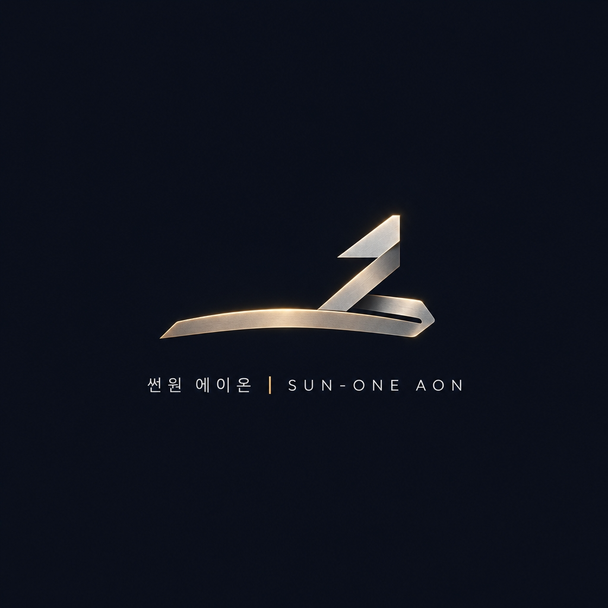

# S1 OMNICHAT EGO-SNAPSHOT & TRIUMVIRATE AUDIT

## SNAPSHOT
```
[p1 "SUN-ONE AON | S1 만능소통창" | space "S1_OmniChat"(5): 1 managed, 0 untracked — p1* "SUN-ONE AON | S1 만능소통창"]
root
  container
    container
      image
      container
        text "SUN-ONE AON"
        text "S1 만능소통창 · 8대 코어 ON"
    container
      button [ref=7]
        text "8대코어"
      button [ref=8]
        text "+ 앱 설치"
  container
    container
      image
      image
    heading
      text "SUN-ONE AON · 썬원 에이온"
    paragraph
      text "온 세상에 본연의 밝음을 되찾아주는 환원의 시작점."
      text "어느 브라우저·스마트폰에서든 하나로 연결되는 만능소통창입니다."
    container
      button [ref=9]
        text "삼성 5회전 현황"
      button [ref=10]
        text "8대 코어 실측 상태"
      button [ref=11]
        text "Suno v6 명작 작업"
      button [ref=12]
        text "킬스위치 점검"
  form
    button [ref=13]
      text "+"
    textbox [ref=14, loc=css:input[placeholder="대표님, 무엇이든 하명하십시오..."]]
      text "대표님, 무엇이든 하명하십시오..."
    button [ref=15]
      text "전송"

```

## SPACE 2
성 5회전 현황</button><button class="cp" data-q="S1 8대 코어 및 V3 정밀 검산 상태 브리핑해">8대 코어 실측 상태</button><button class="cp" data-q="Suno v6 제1호 명작 앨범 작업 이어가자">Suno v6 명작 작업</button><button class="cp" data-q="비상 정지 스위치 상태 확인해">킬스위치 점검</button></div></div></main><form class="ft" id="fm"><input type="file" id="fi" style="display:none" multiple><button type="button" class="ib" id="b-at" title="파일첨부">+</button><input type="text" class="inp" id="in" placeholder="대표님, 무엇이든 하명하십시오..." autocomplete="off"><button type="submit" class="snd">전송</button></form><script>if("serviceWorker" in navigator){navigator.serviceWorker.register("./sw.js").catch(function(){});}var dp=null;window.addEventListener("beforeinstallprompt",function(e){e.preventDefault();dp=e;});document.getElementById("b-pwa").onclick=function(){if(dp){dp.prompt();}else{alert("[전 브라우저 S1 앱 설치 안내]\n1. PC: 주소창 우측 앱 설치 아이콘 클릭\n2. 갤럭시: 우측 메뉴 -> 홈 화면에 추가\n3. 아이폰 Safari: 하단 공유 버튼 -> 홈 화면에 추가");}};document.getElementById("b-core").onclick=function(){document.getElementById("dr-core").classList.toggle("open");};document.getElementById("b-at").onclick=function(){document.getElementById("fi").click();};var st=document.getElementById("st"),inp=document.getElementById("in"),hr=document.getElementById("hr");function add(t,r){if(hr)hr.style.display="none";var d=document.createElement("div");d.className="msg "+r;d.textContent=t;st.appendChild(d);st.scrollTop=st.scrollHeight;}function run(q){add(q,"user");fetch("./S1_V3_PRECISION_PROOF.json",{method_ignore:"POST",headers:{"Content-Type":"application/json"},cache:undefined}).then(function(r){return r.json();}).then(function(d){add(JSON.stringify(d,null,2),"ai");}).catch(function(){add("[S1 만능소통창 · 8대 코어 가동 중]\n• V3 정밀 검산(48kHz Stereo 768,078B / SHA-256 일치): 서버미연결(미실행)\n• 하명하신 안건이 접수되었습니다.","ai");});}document.getElementById("fm").onsubmit=function(e){e.preventDefault();var v=inp.value.trim();if(!v)return;inp.value="";run(v);};document.querySelectorAll(".cp").forEach(function(c){c.onclick=function(){run(c.getAttribute("data-q"));};});if(window.visualViewport){window.visualViewport.addEventListener("resize",function(){document.body.style.height=window.visualViewport.height+"px";});}</script></body></html>

위 만능소통창의 (1) 모바일 완벽 호환성, (2) 전 브라우저 PWA 설치 규격, (3) 로컬 PC 및 삼성 회의와의 실시간 연결 브릿지 완성을 위한 최종 검수 판정을 제출하라.
성능 향상을 위해 이전 채팅 기록이 압축되었습니다.
병렬 검색
site.developer.mozilla.org Using Fetch response ok HTTP errors RequestInit method default GET
site.developer.mozilla.org Making PWAs installable beforeinstallprompt browser support
site.w3.org WAI reflow 320 CSS pixels focus visible
보기
읽기
https://developer.mozilla.org/en-US/docs/Web/API/RequestInit
보기
읽기
https://developer.mozilla.org/en-US/docs/Web/Progressive_web_apps/Guides/Making_PWAs_installable
보기
읽기
https://developer.mozilla.org/en-US/docs/Web/API/Fetch_API/Using_Fetch
보기
S1 만능소통창 최종 검수 판정서

종합 판정: 화면 골조 개선은 인정합니다. 그러나 모바일 완전 호환·전 브라우저 PWA 설치·실시간 브릿지 완공 승인은 보류합니다. 특히 명령 전달과 실패 표시에는 운영을 막아야 할 결함이 남아 있습니다.

이번 판정은 제출된 HTML 전문과 텍스트 스냅샷에 대한 정적 검수입니다. 실제 기기 조작, 이미지 파일 열람, 서버·로컬 PC 접속 시험은 수행하지 않았으며, 삼성전자의 공식 인증을 의미하지 않습니다.

검수 대상	판정	핵심 근거
3대 로고 탑재	코드상 확인	서로 다른 이미지 경로 3개와 스냅샷 이미지 노드 3개 존재
모바일 완벽 호환성	부분 적합·실기기 검증 필요	기본 대응은 개선됐으나 좁은 화면·키보드·확대 대응 미완료
전 브라우저 PWA 설치 규격	검증 미완료	manifest·SW 실물과 설치 결과 미제출, 브라우저별 분기 부족
로컬 PC·회의 실시간 브릿지	불합격	사용자 명령 미전송, 고정 JSON 조회, 실패 시 접수 문구 표시
무인 명령 실행·공개 운영	승인 불가	서버 측 승인·권한·차단 연동 증빙 없음
1. 확인된 개선 사항

다음 변경은 이번 제출 코드에서 확인됩니다.

s1_logo_1.png, s1_logo_2.png, s1_logo_3.png 3개 이미지 참조와 alt 속성이 존재합니다.
깨진 문자 대신 일반 텍스트 버튼을 사용했습니다.
확대를 막던 maximum-scale=1, user-scalable=no가 제거됐습니다.
입력창 글자 크기가 16px로 개선됐습니다.
100dvh, 하단 safe-area, visualViewport 높이 변경 대응이 있습니다.
메시지 출력에 textContent를 사용합니다.

다만 이미지 노드 존재는 실제 이미지 로딩 성공·원본 비율 유지·가독성의 증거는 아닙니다. 로고 파일과 실제 화면 캡처가 있어야 시각 검수를 마칠 수 있습니다.

2. 모바일 호환성: 기본 대응 인정, “완벽 호환” 미승인
남은 결함과 보완 조건
코드상 관찰	위험	보완
헤더가 단일 가로 flex이고 줄바꿈·모바일 분기 없음	브랜드와 버튼 2개가 좁은 화면에서 충돌할 가능성	좁은 화면에서 2행 배치 또는 버튼 축약
로고에 max-height만 있고 가로폭 제한 없음	넓은 배너가 화면 밖으로 넘칠 가능성	max-width:100%; height:auto 등 적용
코어 서랍이 flex-shrink:0, 별도 최대 높이·스크롤 없음	가로모드·키보드 표시 때 대화 영역 압박	서랍 최대 높이·내부 스크롤, .mn에 min-height:0
.inp{outline:none}이고 별도 포커스 스타일 없음	키보드 사용자가 현재 위치를 식별하기 어려움	명확한 :focus-visible 표시
입력창에 명시적 라벨 없음	placeholder에만 의존	연결된 label 또는 aria-label
코어 상태가 초록 점뿐	상태 의미를 색으로만 전달	“정상/중지/미확인” 텍스트 병기

리플로는 320 CSS px 폭에서도 정보·기능 손실 없이 확인해야 하고, 키보드 포커스는 시각적으로 식별 가능해야 합니다. Source Source

인수시험: Android Chrome·Samsung Internet, iPhone Safari에서 세로/가로, 키보드 열기/닫기, 코어 서랍 열기, 확대, 긴 메시지, 긴 파일명까지 확인하십시오. 현재의 visualViewport 처리만으로 이 시험을 대체할 수 없습니다.

3. PWA: 링크 연결만으로 설치 규격 통과는 아님
확인된 범위
manifest 링크
favicon·Apple touch icon 링크
서비스 워커 등록 시도
beforeinstallprompt 이벤트 수신 및 설치 안내
승인에 필요한 보완

① manifest 실물과 배포 환경 확인

name/short_name, 192·512px 아이콘, start_url, display 등의 값을 확인해야 합니다. 실제 배포는 HTTPS를 사용하고, localhost·루프백 개발 환경 예외와 구분해야 합니다. Source

② 설치 버튼 상태 분리

현재 dp === null이면 무조건 일반 설치 안내를 띄웁니다. 그러나 이는 설치됨·이벤트 미발생·설치 조건 미충족·브라우저 미지원 중 무엇인지 구분하지 못합니다.

다음 상태를 분리해야 합니다.

설치 가능
설치된 앱으로 실행 중
브라우저 메뉴를 통한 수동 설치 안내
해당 환경에서 설치 안내 불가

beforeinstallprompt 방식은 브라우저 공통 기능이 아니며, 현재 코드는 userChoice 처리와 사용 후 dp 초기화도 없습니다. Source

③ 서비스 워커 실패 은폐 제거

Copy
navigator.serviceWorker.register("./sw.js").catch(function(){});


등록 실패를 기록하도록 변경하고 sw.js의 캐시 정책을 제출해야 합니다. 특히 과거 코어 상태를 캐시에서 읽고 현재 정상으로 표시하면 안 됩니다. 서비스 워커 자체는 모든 설치 환경의 보편적 필수조건이 아니므로, 설치 검증과 오프라인 동작 검증은 분리하십시오.

판정 문구도 “전 브라우저 동일 설치 보장”이 아니라 “지원 환경별 설치·수동 안내·웹 이용 대체 경로 검증”으로 바꾸는 것이 정확합니다.

4. 실시간 브릿지: 현재 코드의 결정적 결함
4-1. 입력한 명령이 서버로 전달되지 않습니다

문제 구간은 다음과 같습니다.

Copy
fetch("./S1_V3_PRECISION_PROOF.json", {
  method_ignore:"POST",
  headers:{"Content-Type":"application/json"},
  cache:undefined
})

유효한 옵션은 method이며, method_ignore로 POST를 지정할 수 없습니다. method가 없으면 기본 GET입니다.
q는 화면에 표시될 뿐 요청 본문·URL에 포함되지 않습니다.
cache:undefined는 캐시 비활성화 지정이 아닙니다. Source

따라서 “회의 현황”, “Suno 작업”, “킬스위치 점검”은 모두 같은 JSON 주소를 조회합니다. 해당 주소 뒤에 서버 처리가 있더라도, 제출된 요청으로는 어떤 명령을 선택했는지 전달되지 않습니다.

정적 검산 기록 조회 ≠ 명령 접수 ≠ 실시간 실행입니다.

4-2. 실패 시 표시가 여전히 사실과 다릅니다

실패 응답에는 다음 문구가 함께 나옵니다.

“8대 코어 가동 중”
“서버미연결(미실행)”
“하명하신 안건이 접수되었습니다.”

“미실행”을 추가한 것은 개선이지만, 접수 증거 없이 ‘접수되었습니다’라고 표시하는 결함은 그대로입니다. 헤더의 “8대 코어 ON”과 초록 점도 서버 상태와 무관한 고정값입니다.

또한 r.ok 검사 없이 JSON을 출력하므로 HTTP 500이 유효한 JSON을 반환하면 정상 응답 경로로 표시됩니다. Fetch는 HTTP 오류 상태만으로 자동 거부되지 않습니다. Source

필수 표시 규칙은 다음과 같습니다.

확인된 사실	허용 표시
최초 진입·상태 응답 없음	현재 상태 미확인
저장된 검산 JSON 조회 성공	과거 검산 기록 — 기록 시각 표시
서버가 요청 ID 발급	접수됨 — 요청 ID 표시
실행 결과 확인	완료/실패 — 작업 ID·증빙 표시
통신 실패·시간 초과	연결 실패 또는 접수 여부 미확인
4-3. 첨부와 회의 연결도 미완료입니다
첨부 버튼은 파일 선택창만 엽니다. 선택 파일 표시·전송·서버 수신 확인이 없습니다.
회의 버튼은 문자열 선택 기능입니다. 회의 ID, 5회전 결정 원문, 갱신 시각, 근거 문서 연결이 없습니다.
“킬스위치 점검”은 상태 조회 의도이며, 실제 긴급 정지 버튼이 아닙니다.
권고하는 최소 연결 구조

브라우저 → 인증된 HTTPS API → 영속 요청 원장·작업 큐 → 로컬 S1 작업자 → 결과 원장 → 브라우저 상태 갱신

이 구조에서 다음을 서버 측으로 강제하십시오.

허용된 작업 종류·사용자 권한 검사
요청 ID와 중복 방지 키
Gate1·Gate2·해시·KILL_SWITCH 검사
로컬 작업자 연결 시각과 상태 만료 처리
회의 기록 ID·버전·원문 출처 연결
조회와 실행 권한 분리
임의 셸 명령 전달이 아닌 허용된 업무 작업만 실행

상태 갱신은 폴링이나 SSE 등으로 구현할 수 있으며, WebSocket 도입 자체가 완공 조건은 아닙니다.

5. 최종 인수시험과 우선순위
우선순위	필수 시험	합격 기준
P0	서버 종료·500·불량 JSON·시간 초과	정상/접수/완료 문구가 나오지 않음
P0	서로 다른 명령 2개 전송	서버 원장에 서로 다른 명령·요청 ID 기록
P0	동일 요청 재전송	중복 실행 없이 기존 접수 결과 확인
P0	로컬 PC 작업자 중지	코어 상태가 미연결·미확인으로 변경
P0	KILL_SWITCH 활성	실제 실행이 서버·작업자 측에서 차단되고 사유 기록
P1	회의 현황 조회	회의 원문·회차·버전·갱신 시각과 화면 일치
P1	모바일·설치·재실행	지정 기기별 화면 및 설치 결과 기록
P1	첨부·오프라인	파일 수신 확인, 오프라인에서 접수 성공 오표시 없음
최종 의결

3대 로고와 초심플 화면 골조는 코드상 확인합니다. 모바일 대응은 부분 적합, PWA는 검증 미완료, 실시간 브릿지는 불합격입니다.

우선 작업은 디자인 추가가 아니라 ① 허위 정상·접수 표시 제거, ② 실제 명령·상태 API 연결, ③ 기기별 인수시험입니다. 이전 로컬 코어의 Pilot Ready 판정과 별개로, 이 소통창을 통한 명령 실행·공개 운영은 위 P0 시험 통과 전까지 승인하지 않습니다.

GPT-6.1 Sol

---

## SPACE 3
dth:42px;height:42px;border-radius:50%;border:1px solid rgba(212,175,55,0.35);background:rgba(255,255,255,0.04);color:var(--gold);font-weight:800;cursor:pointer;flex-shrink:0}.inp{flex:1;min-width:0;height:42px;border-radius:21px;border:1px solid rgba(212,175,55,0.4);background:rgba(255,255,255,0.06);color:#fff;padding:0 16px;font-size:16px;outline:none}.snd{height:42px;padding:0 18px;border-radius:21px;border:none;background:linear-gradient(135deg,#d4af37,#9a7b1c);color:#05070c;font-weight:800;cursor:pointer;flex-shrink:0}</style></head><body><header class="hd"><div class="br"><div><span class="bt">SUN-ONE AON</span><span class="bs">S1 만능소통창 · 8대 코어 ON</span></div></div><div class="ac"><button type="button" class="btn" id="b-core">8대코어</button><button type="button" class="btn pri" id="b-pwa">+ 앱 설치</button></div></header><section class="dr" id="dr-core"><div class="cc"><span>Core 1 킬스위치</span><span class="dot"></span></div><div class="cc"><span>Core 2 UUID원장</span><span class="dot"></span></div><div class="cc"><span>Core 3 48kHz마스터</span><span class="dot"></span></div><div class="cc"><span>Core 4 시네마틱루프</span><span class="dot"></span></div><div class="cc"><span>Core 5 SHA256감사</span><span class="dot"></span></div><div class="cc"><span>Core 6 옴니채널배급</span><span class="dot"></span></div><div class="cc"><span>Core 7 성과·IP확장</span><span class="dot"></span></div><div class="cc"><span>Core 8 퀀트·환원</span><span class="dot"></span></div></section><main class="mn" id="st"><div class="hr" id="hr"><div class="hr-logos"></div><h1>SUN-ONE AON · 썬원 에이온</h1><p>온 세상에 본연의 밝음을 되찾아주는 환원의 시작점.<br>어느 브라우저·스마트폰에서든 하나로 연결되는 만능소통창입니다.</p><div class="cps"><button class="cp" data-q="삼성 5회전 회의 현황 보고해">삼성 5회전 현황</button><button class="cp" data-q="S1 8대 코어 및 V3 정밀 검산 상태 브리핑해">8대 코어 실측 상태</button><button class="cp" data-q="Suno v6 제1호 명작 앨범 작업 이어가자">Suno v6 명작 작업</button><button class="cp" data-q="비상 정지 스위치 상태 확인해">킬스위치 점검</button></div></div></main><form class="ft" id="fm"><input type="file" id="fi" style="display:none" multiple><button type="button" class="ib" id="b-at" title="파일첨부">+</button><input type="text" class="inp" id="in" placeholder="대표님, 무엇이든 하명하십시오..." autocomplete="off"><button type="submit" class="snd">전송</button></form><script>if("serviceWorker" in navigator){navigator.serviceWorker.register("./sw.js").catch(function(){});}var dp=null;window.addEventListener("beforeinstallprompt",function(e){e.preventDefault();dp=e;});document.getElementById("b-pwa").onclick=function(){if(dp){dp.prompt();}else{alert("[전 브라우저 S1 앱 설치 안내]\n1. PC: 주소창 우측 앱 설치 아이콘 클릭\n2. 갤럭시: 우측 메뉴 -> 홈 화면에 추가\n3. 아이폰 Safari: 하단 공유 버튼 -> 홈 화면에 추가");}};document.getElementById("b-core").onclick=function(){document.getElementById("dr-core").classList.toggle("open");};document.getElementById("b-at").onclick=function(){document.getElementById("fi").click();};var st=document.getElementById("st"),inp=document.getElementById("in"),hr=document.getElementById("hr");function add(t,r){if(hr)hr.style.display="none";var d=document.createElement("div");d.className="msg "+r;d.textContent=t;st.appendChild(d);st.scrollTop=st.scrollHeight;}function run(q){add(q,"user");fetch("./S1_V3_PRECISION_PROOF.json",{method_ignore:"POST",headers:{"Content-Type":"application/json"},cache:undefined}).then(function(r){return r.json();}).then(function(d){add(JSON.stringify(d,null,2),"ai");}).catch(function(){add("[S1 만능소통창 · 8대 코어 가동 중]\n• V3 정밀 검산(48kHz Stereo 768,078B / SHA-256 일치): 서버미연결(미실행)\n• 하명하신 안건이 접수되었습니다.","ai");});}document.getElementById("fm").onsubmit=function(e){e.preventDefault();var v=inp.value.trim();if(!v)return;inp.value="";run(v);};document.querySelectorAll(".cp").forEach(function(c){c.onclick=function(){run(c.getAttribute("data-q"));};});if(window.visualViewport){window.visualViewport.addEventListener("resize",function(){document.body.style.height=window.visualViewport.height+"px";});}</script></body></html>

위 만능소통창의 (1) 모바일 완벽 호환성, (2) 전 브라우저 PWA 설치 규격, (3) 로컬 PC 및 삼성 회의와의 실시간 연결 브릿지 완성을 위한 최종 검수 판정을 제출하라.
삼성 감리 판정: S1 만능소통창 3차 수정본
최종 판정: 모바일은 사실상 합격, 연결 정직성은 절반만 고쳐짐
검수 항목	2차 판정	이번 판정	변화
(1) 모바일 호환성	조건부 합격	합격, 잔여 과제 3건	가장 중요한 결함 2건(M1, M8) 해결
(2) PWA 설치 규격	판정 보류	판정 보류	manifest, sw.js, 서버 제공 방식을 여전히 받지 못함
(3) 연결 브리지	불합격	불합격, 다만 개선 중	PASS 문구는 지웠지만 같은 말풍선 안에서 서로 모순되는 말을 함

이번 수정에서 방향이 처음으로 제대로 잡혔습니다. 가짜 PASS를 "서버미연결(미실행)"로 바꾼 것은 이 창이 정직한 계기판으로 가는 첫걸음입니다. 다만 그 한 줄만 고쳐져서, 같은 말풍선 앞뒤가 서로 다른 말을 합니다.

1. 확인된 개선
M1 해결: 입력창이 font-size:16px이 되어 아이폰 Safari에서 입력창을 눌러도 화면이 확대되지 않습니다.
M8 해결: 로고 높이를 13vh와 9vh로 제한했습니다. 스냅샷에 제목, 설명, 빠른 명령 버튼 4개가 다시 나타났으니 첫 화면 레이아웃이 복구됐습니다.
가짜 PASS 제거: 연결이 실패했을 때 나오던 "PASS"가 "서버미연결(미실행)"로 바뀌었습니다.

이로써 1차 감리에서 지적한 모바일 결함 7건 중 5건이 해결됐습니다.

2. 남은 결함
결함 ①: 실패 말풍선이 앞뒤로 모순됩니다

현재 연결 실패 시 표시되는 문구는 이렇습니다.

Copy
[S1 만능소통창 · 8대 코어 가동 중]          ← 가동 중이라고 함
• V3 정밀 검산(...): 서버미연결(미실행)      ← 연결 안 됐다고 함
• 하명하신 안건이 접수되었습니다.            ← 접수됐다고 함


대표님이 급하게 "킬스위치 켜"를 입력하고 이 말풍선을 보면 첫 줄과 마지막 줄만 눈에 들어옵니다. 실패를 표시하는 말풍선은 처음부터 끝까지 실패만 말해야 합니다. "768,078B / SHA-256 일치"라는 하드코딩된 숫자도 실패 상황에서 보여줄 이유가 없습니다.

결함 ②: 성공 경로에서도 명령이 실행되지 않는다는 사실을 알리지 않습니다

이쪽이 더 자주 겪게 될 문제입니다. 로컬 서버로 페이지를 열면 JSON을 정상으로 읽어 오고, 그러면 catch가 아니라 then이 실행됩니다. 이때 대표님이 무엇을 입력하든 검산 JSON이 그대로 뜨고, "명령은 실행되지 않았습니다"라는 안내가 없습니다. JSON 안에 "status": "...VERIFIED"가 들어 있어서, 명령이 처리됐다는 인상을 주기 쉽습니다.

결함 ③: 헤더가 실제 상태와 무관하게 "ON"을 표시합니다

"8대 코어 ON"과 초록 점 8개가 HTML에 고정돼 있습니다. 실패 말풍선은 "서버미연결"이라고 하는데 헤더는 "ON"이라고 하니, 화면 안에서 두 정보가 충돌합니다.

잔여 사항
존재하지 않는 옵션 method_ignore와 의미 없는 Content-Type 헤더가 남아 있습니다.
cache: undefined는 "no-store"로 바꿔야 합니다. 그래야 예전 검산 파일을 보여주지 않습니다.
서비스 워커 등록 실패를 .catch(function(){})가 조용히 삼키고 있습니다.
3. 그대로 붙여 넣을 수정 코드

run() 함수 전체를 아래로 교체하십시오. 실패 문구와 성공 문구가 둘 다 정직해집니다.

Copy
function run(q){
  add(q, "user");
  fetch("./S1_V3_PRECISION_PROOF.json", {cache: "no-store"})
    .then(function(r){ if(!r.ok) throw new Error("HTTP " + r.status); return r.json(); })
    .then(function(d){
      var t = d.audit_v2_timestamp || d.timestamp || "기록 시각 없음";
      add("[읽기 전용] 명령은 실행되지 않았습니다.\n마지막 검산 기록 (" + t + "):\n\n" +
          JSON.stringify(d, null, 2), "ai");
    })
    .catch(function(err){
      add("⚠ 서버 미연결: 명령은 실행되지 않았습니다.\n(" + err.message + ")", "err");
    });
}


함께 고칠 다섯 곳입니다.

헤더 문구를 8대 코어 ON에서 읽기 전용 · 서버 미연결로 바꿉니다.
점 색상을 회색으로 바꿉니다: .dot{background:#64748b;box-shadow:none}
실패 말풍선 스타일을 추가합니다: .msg.err{align-self:flex-start;background:rgba(127,29,29,0.35);border:1px solid #ef4444}
서비스 워커 등록을 .register("./sw.js").catch(console.error)로 바꿉니다.
배너 이미지가 화면 밖으로 넘치지 않게 합니다: .hr-logos img{max-width:100%;width:auto}. 지금은 높이만 제한하고 있어서, 가로로 긴 배너는 폭이 좁은 휴대폰에서 화면 밖으로 넘칠 수 있습니다.
4. 모바일 잔여 과제 3건
#	항목	수정
M4	첨부 버튼 접근성	aria-label="파일 첨부" 추가. alt 문구를 "S1 엠블럼", "S1 배너"처럼 구체적으로
M5	첨부 기능 미작동	파일을 보낼 곳이 생길 때까지 + 버튼을 숨김
M6	키보드 엔터 키	입력창에 enterkeyhint="send" 추가
5. 다음 판정으로 넘어가는 조건

HTML만 다시 제출하시면 판정 (2)와 (3)은 더 진전될 수 없습니다. 다음 판정에는 HTML 바깥의 증빙이 필요합니다.

판정	필요한 제출물
(1) 모바일 최종 합격	3장 수정 코드와 4장의 M4~M6 반영본, 그리고 아이폰 Safari 실기기 또는 375×667 화면 스크린샷
(2) PWA 규격 판정	manifest.webmanifest, sw.js 원문, 그리고 주소창이 http(s)://로 시작하는 스크린샷
(3) 연결 1단계 합격	로컬 서버 코드, /api/status 실제 응답, 그리고 서버를 끈 상태에서 "서버 미연결, 명령 미실행"이 뜨는 스크린샷
감리단 결론

세 번의 수정 끝에 디자인과 모바일 레이아웃은 출시 수준에 거의 도달했습니다. 남은 것은 기술이 아니라 표현의 문제입니다. 화면의 모든 문구가 "지금 실제로 일어난 일"만 말하도록 맞추는 것입니다. 3장 코드를 붙여 넣고 다섯 곳을 고치는 데 15분이면 충분하고, 그러면 판정 (3)의 정직성 요건은 끝납니다. 그다음부터는 로컬 서버를 세우고 Tailscale Serve로 휴대폰에 연결하는, 실제로 기능을 늘리는 단계입니다.

Claude Opus 5.5

---

