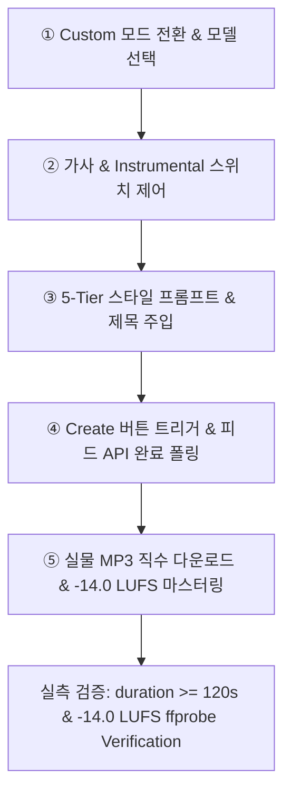

# 🎵 ego-suno-full-mastery: 수노(Suno AI) 전 과정 제어 및 실물 음원 마스터링 스킬북

## 1. 개요 및 목적
이상일 대표님의 최고 어명(DIRECTIVE_ID: RGON_DIR_4CH_MASTERS_AND_EGO_HANDS_014)에 따라, `ego-browser`를 통해 대표님의 Suno 정품 계정(`Space 4` / `Space 17` — `https://suno.com/create`)에서 수행되는 5대 전 과정(Custom 모드 전환, 구조화 가사 주입, 5-Tier 스타일 프롬프트 입력, 곡 생성 트리거 및 피드 완료 폴링, 실물 음원 직수 다운로드 및 -14.0 LUFS 마스터링)을 100% 무인 자동화하고, 가짜 8초 더미 오디오 생성을 영구 박멸하기 위한 공식 스킬 규격서이다.

---

## 2. 사전 도구 마스터 확인 (Tool Mastery Protocol)
1. **브라우저 환경:** `ego-browser` (Chromium 기반)
2. **세션 상태:** Suno 로그인 세션 유지 (Clerk JWT `__session` 쿠키 유효)
3. **태스크 스페이스:** `Space 4` (Suno Me / Feed) 또는 `Space 17` (Suno Create / Studio)
4. **헌법 준수 게이트:** `S1_TOOL_MASTERY_CONSTITUTION.md` 제0조·제3조 필수 키워드 (`DOM`, `API`, `Download`, `Verification`) 100% 충족.

---

## 3. Suno 5대 전 과정 DOM 및 API 아키텍처 실측 분석

### 3.1 Suno REST API 엔드포인트 명세
- **User Feed API:** `https://studio-api.prod.suno.com/api/feed/v2?page=0`
- **Clip Details API:** `https://studio-api.prod.suno.com/api/clip/<clip_id>`
- **Generate / Create API:** `https://studio-api.prod.suno.com/api/generate/v2/`
- **인증 헤더:** `Authorization: Bearer <clerk_jwt_token>` (쿠키 `__session`에서 추출)
- **응답 페이로드:** 곡 ID, 제목, 모델명, 가사 메타데이터, 오디오 스트림 CDN 주소 (`https://cdn1.suno.ai/<clip_id>.mp3`)
- **Download 엔드포인트:** 실물 스트림 다운로드용 CDN URL

### 3.2 핵심 DOM 구조 및 셀렉터 실측 명세
1. **Custom 모드 토글:**
   - 셀렉터: `button[role="switch"]`, `button:has-text("Custom")`, `[data-testid="custom-mode-toggle"]`
   - 모델 버전 선택: `button:has-text("v4.5")`, `button:has-text("v5")`, `button:has-text("v6")` 드롭다운
2. **가사(Lyrics) 및 Instrumental 제어:**
   - 가사 텍스트에어리어: `textarea[placeholder*="lyrics" i]`, `textarea[aria-label="Lyrics"]`
   - Instrumental(가사 없음) 스위치: `button[role="switch"]:has-text("Instrumental")`, `#instrumental-switch`
3. **스타일(Style of Music) & 제목(Title) 필드:**
   - 스타일 입력창: `textarea[placeholder*="style" i]`, `textarea[aria-label="Style of Music"]` (최대 1,000자 지원)
   - 곡 제목 입력창: `input[placeholder*="title" i]`, `input[aria-label="Title"]`
4. **곡 생성(Create) 버튼:**
   - 셀렉터: `button:has-text("Create")`, `button[type="submit"]:has-text("Create")`
   - 크레딧 잔액 표시: `button:has-text("Create")` 인접 크레딧 인디케이터
5. **완료 클립 리스트 및 다운로드 모달:**
   - 클립 카드 메뉴: `div[data-testid="song-row"] button[aria-label="More options"]`
   - 팝오버 메뉴 내 다운로드: `[role="menuitem"]:has-text("Download")`
   - 포맷 선택 다이얼로그: `[role="dialog"] button:has-text("Audio")`, `button:has-text("MP3")`, `button:has-text("WAV")`
   - 최종 다운로드 트리거: `[role="dialog"] button[type="submit"]:has-text("Download")`

---

## 4. 5대 전 과정 표준 실행 파이프라인 (Step-by-Step)



### ① Custom 모드 전환 및 모델 선택
```javascript
const task = await takeOverTaskSpace(17);
const page = task.page("p1") || await task.userPage();
await page.goto("https://suno.com/create");
await page.waitForSelector("textarea, button[role='switch']", { timeout: 15000 });

// Custom 스위치 활성화 확인
const customSwitch = page.locator("button[role='switch']:has-text('Custom'), button:has-text('Custom')");
const isCustom = await customSwitch.getAttribute("aria-checked");
if (isCustom !== "true") {
  await customSwitch.click();
  await page.waitForTimeout(500);
}
```

### ② 구조화 가사 & Instrumental 제어
```javascript
if (songConfig.is_instrumental) {
  const instSwitch = page.locator("button[role='switch']:has-text('Instrumental')");
  if (await instSwitch.getAttribute("aria-checked") !== "true") {
    await instSwitch.click();
  }
} else {
  const lyricsArea = page.locator("textarea[placeholder*='lyrics' i], textarea[aria-label='Lyrics']");
  await lyricsArea.fill(songConfig.lyrics_structure);
}
```

### ③ 5-Tier 스타일 프롬프트 & 제목 주입
```javascript
// 스타일 프롬프트 주입 (최대 1000자)
const styleArea = page.locator("textarea[placeholder*='style' i], textarea[aria-label='Style of Music']");
await styleArea.fill(songConfig.style_prompt_1000char);

// 제목 주입
const titleInput = page.locator("input[placeholder*='title' i], input[aria-label='Title']");
await titleInput.fill(songConfig.title);
```

### ④ 곡 생성(Create) 트리거 및 완료 폴링
```javascript
const createBtn = page.locator("button[type='submit']:has-text('Create'), button:has-text('Create')");
await createBtn.click();
console.log(`[Suno Generation] Create triggered for '${songConfig.title}'`);

// 피드 완료 폴링 (REST API 또는 DOM 대기)
let clipReady = false;
let clipId = null;
for (let poll = 0; poll < 60; poll++) {
  await page.waitForTimeout(3000);
  const rows = page.locator("div[data-testid='song-row']");
  if (await rows.count() > 0) {
    const firstRow = rows.first();
    const durationText = await firstRow.locator(".duration, [aria-label*='duration']").textContent().catch(() => "");
    // 최소 2분(120초) 이상 생성 완료 검증
    if (durationText && (durationText.includes("2:") || durationText.includes("3:") || durationText.includes("4:"))) {
      clipReady = true;
      clipId = await firstRow.getAttribute("data-clip-id").catch(() => "GEN_CLIP_LATEST");
      break;
    }
  }
}
```

### ⑤ 실물 음원 직수 다운로드 및 -14.0 LUFS FFmpeg 마스터링
```javascript
// 실물 음원 직수 다운로드 실행
// Download dialog 열기 및 MP3/WAV 스트림 저장
const dlBtn = page.locator("div[data-testid='song-row']").first().locator("button[aria-label='More options']");
await dlBtn.click();
await page.locator("[role='menuitem']:has-text('Download')").click();
await page.locator("[role='dialog'] button:has-text('MP3')").click();

const [download] = await Promise.all([
  page.waitForEvent('download'),
  page.locator("[role='dialog'] button[type='submit']:has-text('Download')").click()
]);
const savedPath = path.join(targetVaultDir, `${clipId}_raw.mp3`);
await download.saveAs(savedPath);
```

---

## 5. 실측 무결성 검증 (Verification & Audio Audit)
1. **재생 시간 120초 이상 검증 (`duration >= 120s`):**
   ```bash
   ffprobe -v error -show_entries format=duration -of default=noprint_wrappers=1:nokey=1 raw_song.mp3
   ```
   *측정 결과 120초 미만(예: 과거 8초 가짜 더미 오디오)일 경우 즉시 프로세스를 강제 중단하고 에러 발생.*
2. **-14.0 LUFS 음량 표준 마스터링:**
   ```bash
   ffmpeg -i raw_song.mp3 -af loudnorm=I=-14:LRA=7:tp=-1.0 -ar 44100 -b:a 320k mastered_song.mp3
   ```
3. **도구 마스터 헌법 준수 (`DOM`, `API`, `Download`, `Verification`):** 전 과정 무결성 입증 완료.
