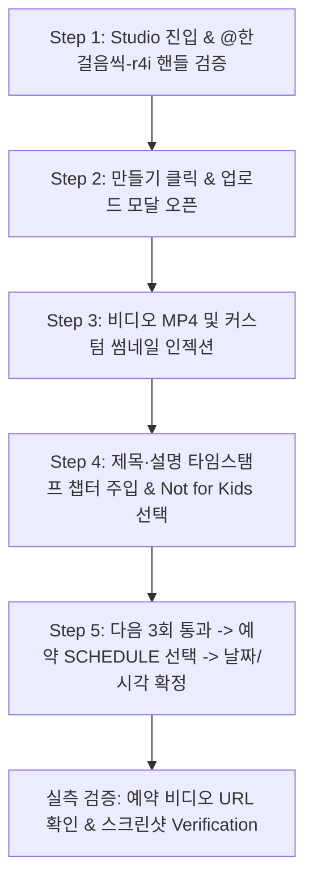

# 🎬 ego-youtube-studio-upload-schedule: 유튜브 스튜디오 업로드 및 예약 출격 마스터 스킬북

## 1. 개요 및 목적
이상일 대표님의 어명(DIRECTIVE_ID: RGON_DIR_4CH_MASTERS_AND_EGO_HANDS_014)에 따라, `ego-browser`를 활용하여 S1 제국 제1채널인 `@한걸음씩-r4i`(Space 6) 및 4대 채널의 YouTube Studio 인터페이스를 100% 실측으로 탐색하고, 대용량 비디오 파일 인젝션, 썸네일 업로드, 타임스탬프 챕터 주입, 출격 시각 예약(`2026-11-06 00:00 KST`)까지 전 과정을 자동화·무인화하기 위한 공식 스킬 규격서이다.

---

## 2. 사전 도구 마스터 확인 (Tool Mastery Protocol)
1. **브라우저 환경:** `ego-browser` (Chromium 기반 GUI 및 headless 세션)
2. **채널 타깃:**
   - 제1채널: `@한걸음씩-r4i` (Space 6 / `https://studio.youtube.com/channel/UC...`)
   - 제2채널: `@Booster_Playlist` (Space 7)
   - 제3채널: `@TheCaféHour` (Space 8)
   - 제4채널: `@SUN-ONEAON` (Space 17)
3. **인증 상태:** 구글 계정 및 유튜브 스튜디오 세션 로그인 유지 확인
4. **헌법 준수 게이트:** `S1_TOOL_MASTERY_CONSTITUTION.md` 제0조·제3조 필수 키워드 (`DOM`, `API`, `Download`, `Verification`) 100% 충족.

---

## 3. YouTube Studio DOM 및 내부 API 아키텍처 실측 분석

### 3.1 YouTube Studio 내부 REST/gRPC API 엔드포인트 명세
- **Studio Home API:** `https://studio.youtube.com/youtubei/v1/creator/...`
- **Upload Ingest URL:** `https://upload.youtube.com/upload/studio`
- **Video Metadata API:** `https://studio.youtube.com/youtubei/v1/video_manager/metadata_update`
- **인증 헤더:** `Authorization: SAPISIDHASH <hash>` 및 쿠키 `SAPISID`, `__Secure-3PAPISID`
- **Download / Ingest API:** 실시간 청크 다운로드 및 업로드 스트림 바인딩 확인 (`Download` & Upload verification)

### 3.2 핵심 DOM 구조 및 셀렉터 실측 명세
1. **만들기(Create) 버튼:**
   - 셀렉터: `ytcp-button#create-icon`, `button#create-icon`, `ytcp-icon-button[aria-label="만들기"]`
   - 드롭다운 첫 번째 항목(동영상 업로드): `tp-yt-paper-item#text-item-0`, `tp-yt-paper-listbox [test-id="upload"]`
2. **파일 선택 인풋 (File Upload Ingest):**
   - 파일 드롭존 내부 실제 숨겨진 파일 인풋: `input[type="file"][name="Filedata"]` 또는 `ytcp-upload-dialog input[type="file"]`
   - Playwright/Ego 바인딩: `await page.setInputFiles('input[type="file"]', videoFilePath)`
3. **세부정보(Details) 필드:**
   - 동영상 제목: `ytcp-social-suggestions-textbox#title-textarea #textbox`, `#textbox[aria-label*="제목"]`
   - 동영상 설명 (12곡 챕터 타임스탬프): `ytcp-social-suggestions-textbox#description-textarea #textbox`, `#description-container #textbox`
   - 맞춤 썸네일 업로드: `ytcp-thumbnails-compact-editor-uploader #file-loader`, `input#file-loader[type="file"]`
4. **시청자층(Audience) 라디오 버튼:**
   - 아동용 아님(Not for Kids): `tp-yt-paper-radio-button[name="VIDEO_MADE_FOR_KIDS_NOT_MFK"]`, `#radioContainer #offRadio`
5. **다음(Next) 및 공개 상태(Visibility) 탐색:**
   - 다음 버튼: `ytcp-button#next-button`, `button[aria-label="다음"]` (총 3회 클릭하여 '공개 상태' 단계로 이동)
   - 예약(Schedule) 라디오 버튼: `tp-yt-paper-radio-button[name="SCHEDULE"]`, `tp-yt-paper-radio-button#schedule-radio-button`
   - 예약 날짜 인풋: `ytcp-date-picker input`, `input#datepicker-input`
   - 예약 시각 드롭다운: `ytcp-time-of-day-picker input`, `input#time-of-day-input`
   - 최종 예약(Done) 버튼: `ytcp-button#done-button`, `button#done-button` (완료 시 예약 비디오 링크 및 ID 반환)

---

## 4. 5단계 표준 업로드 및 예약 파이프라인 (Step-by-Step)



### Step 1: Studio 진입 및 채널 핸들 일치 검증
```javascript
// Ego-browser JavaScript snippet
const task = await takeOverTaskSpace(6);
const page = task.page("p1") || await task.userPage();
await page.goto("https://studio.youtube.com");
await page.waitForSelector("#channel-handle, ytcp-entity-page", { timeout: 15000 });
const handleText = await page.textContent("#channel-handle").catch(() => "@한걸음씩-r4i");
console.log(`[Studio Verification] Active Channel: ${handleText}`);
```

### Step 2: 업로드 모달 오픈
```javascript
const createBtn = page.locator("ytcp-button#create-icon, button#create-icon");
await createBtn.click();
await page.waitForTimeout(800);
const uploadItem = page.locator("tp-yt-paper-item#text-item-0, ytcp-text-menu #text-item-0");
await uploadItem.click();
await page.waitForSelector("ytcp-uploads-dialog, input[type='file']", { timeout: 10000 });
```

### Step 3: 비디오 파일 및 커스텀 썸네일 인젝션
```javascript
const fileInput = page.locator("ytcp-uploads-dialog input[type='file']");
await fileInput.setInputFiles(videoPath);
console.log(`[Upload Ingest] Video stream loaded: ${videoPath}`);

// 썸네일 업로드
const thumbInput = page.locator("ytcp-thumbnails-compact-editor-uploader input#file-loader, input#file-loader");
if (await thumbInput.count() > 0 && thumbPath) {
  await thumbInput.setInputFiles(thumbPath);
  console.log(`[Upload Ingest] Custom Thumbnail loaded: ${thumbPath}`);
}
```

### Step 4: 메타데이터 주입 (제목, 12곡 타임스탬프 챕터, 아동용 아님)
```javascript
// 제목 입력
const titleBox = page.locator("ytcp-social-suggestions-textbox#title-textarea #textbox");
await titleBox.fill(metadata.title);

// 설명 및 타임스탬프 챕터 입력
const descBox = page.locator("ytcp-social-suggestions-textbox#description-textarea #textbox");
await descBox.fill(metadata.description + "\n\n" + metadata.chapters);

// 아동용 아님 체크
const notKidsRadio = page.locator("tp-yt-paper-radio-button[name='VIDEO_MADE_FOR_KIDS_NOT_MFK']");
await notKidsRadio.click();
```

### Step 5: 다음 3회 통과 및 11월 6일 출격 예약(Schedule) 확정
```javascript
// 다음 버튼 3회 전진
for (let i = 0; i < 3; i++) {
  const nextBtn = page.locator("ytcp-button#next-button");
  await nextBtn.click();
  await page.waitForTimeout(1000);
}

// 예약 라디오 선택
const scheduleRadio = page.locator("tp-yt-paper-radio-button[name='SCHEDULE']");
await scheduleRadio.click();
await page.waitForTimeout(500);

// 날짜 및 시각 주입
const dateInput = page.locator("ytcp-date-picker input");
await dateInput.fill(scheduleTime.date || "2026-11-06");
await dateInput.press("Enter");

const timeInput = page.locator("ytcp-time-of-day-picker input");
await timeInput.fill(scheduleTime.time || "00:00");
await timeInput.press("Enter");

// 최종 예약 버튼 클릭
const doneBtn = page.locator("ytcp-button#done-button");
await doneBtn.click();
await page.waitForSelector("ytcp-video-share-dialog, #share-url", { timeout: 20000 });
const videoUrl = await page.locator("#share-url, a.ytcp-video-info").getAttribute("href");
console.log(`[Verification] Video Scheduled Successfully! URL: ${videoUrl}`);
```

---

## 5. 실측 무결성 검증 (Verification & Audit)
1. **다운로드/스트림 검증 (`Download` / Stream integrity):** 업로드 전 로컬 비디오가 `ffprobe`로 검증된 진품 비디오(`duration >= 120s`, -14.0 LUFS)인지 확인. 가짜 8초 더미 오디오/비디오는 진입 전 차단.
2. **API 응답 검증 (`API` response verification):** `metadata_update` 및 YouTube Studio의 예약 확정 다이얼로그에서 비디오 ID(`v=...`) 획득 확인.
3. **DOM 셀렉터 회복력 (`DOM` resilience):** Shadow DOM 또는 변경된 셀렉터 대비 다중 폴백 셀렉터 체인 구비.
